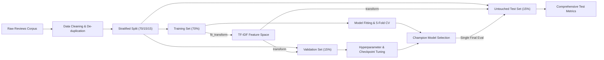
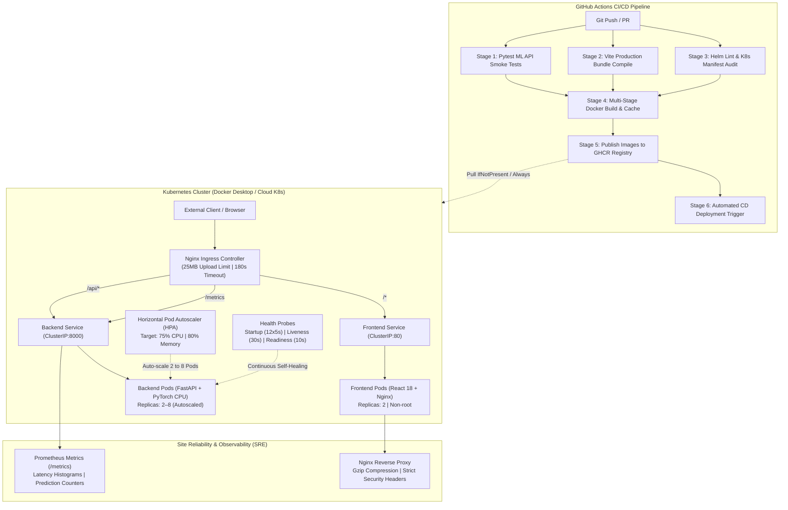

# 📊 McDonald's Review Sentiment Intelligence & Research-Grade Evaluation Platform

> An enterprise-grade Machine Learning & NLP Analytics Platform featuring a rigorous, publication-quality evaluation pipeline for 3-class customer review sentiment analysis (`Negative`, `Neutral`, `Positive`), multi-model benchmarking, interactive web dashboards, bulk review processing, and explainability.

---

## 🔬 Research & Experimental Methodology

### 1. Dataset & Class Distribution
The dataset consists of free-text customer reviews from Google Maps reviews of McDonald's restaurants.

| Sentiment Class | Proportions | Characteristics & Challenges |
| :--- | :--- | :--- |
| **Negative** | **47.34%** | Service delays, order inaccuracies, food quality complaints, cold food |
| **Positive** | **36.94%** | Fast drive-thru, clean locations, friendly staff, hot & fresh food |
| **Neutral** | **15.73%** | Moderate reviews, mixed opinions, indifferent ratings, borderline polarity |

> [!IMPORTANT]
> **Why Accuracy Alone is Insufficient**: Due to class imbalance (Neutral is only 15.73% of the dataset), a naive classifier predicting only Negative and Positive can achieve high accuracy (~84%) while completely failing to identify Neutral reviews (Neutral F1 ≈ 0). Therefore, **Macro F1** is treated as the primary benchmark metric.

---

### 2. Zero-Leakage Experimental Split
To eliminate data leakage, the corpus is partitioned into a strict **3-way stratified split**:
- **70% Training Set**: Used exclusively for model fitting and TF-IDF vocabulary construction.
- **15% Validation Set**: Used exclusively for hyperparameter tuning, loss function weighting, and Transformer checkpoint selection / early stopping.
- **15% Final Untouched Test Set**: Strictly held out until final unbiased evaluation. Never exposed during feature selection, vectorizer fitting, or hyperparameter selection.



---

## 🤖 Model Suite & Architectures

1. **TF-IDF + Linear SVM (`LinearSVC`)**:
   - Hyperplane classifier with cost-sensitive `class_weight='balanced'` to handle the minority Neutral class.
   - N-gram representation: Unigrams + Bigrams, Sublinear TF scaling, max 20,000 features.
2. **TF-IDF + Logistic Regression**:
   - L2-regularized probabilistic classifier with balanced class weights and calibrated probability outputs.
3. **TF-IDF + Multinomial Naive Bayes**:
   - Classical generative probabilistic baseline with Laplace smoothing (`alpha=1.0`).
4. **Fine-Tuned DistilBERT (`distilbert-base-uncased`)**:
   - 66M parameter deep bidirectional Transformer with self-attention.
   - Fine-tuned using cost-sensitive weighted `CrossEntropyLoss` with checkpoint selection driven by validation Macro F1.
5. **VADER Rule-Based Baseline**:
   - Lexicon- and rule-based sentiment intensity analyzer with standard polarity thresholds.

---

## 📂 Project Architecture & Directory Map

```
SENTIMENTAL ANALYSIS/
├── data/                                 # Central Data Repository
│   ├── README.md                         # Data lineage & schema documentation
│   ├── DATASET.csv                       # Raw original McDonald's reviews (33,396 rows)
│   ├── cleaned_reviews.csv               # Normalized & cleaned review texts (22,476 rows)
│   └── final_pseudo_labeled_dataset.csv  # Final consensus ground-truth dataset (22,448 rows)
│
├── Figures/                              # Publication-ready diagnostic figures (01 to 11 .png)
│   ├── 01_sentiment_rating_dist.png      # Sentiment vs Star Rating distribution
│   ├── 02_length_by_sentiment.png        # Character length boxplots
│   ├── 03_autotag_share.png              # Google autotag proportions
│   ├── 04_sentiment_over_time.png        # Longitudinal temporal trends
│   ├── 05_wordclouds.png                 # Sentiment lexicons & word clouds
│   ├── 06_top_bigrams.png                # Top positive / negative n-grams
│   ├── 07_confusion_matrix.png           # Multi-class confusion matrices
│   ├── 08_model_comparison.png           # Accuracy, F1 & Recall benchmarks
│   ├── 09_top_predictive_words.png       # Feature importance / model weights
│   ├── 10_vader_vs_rating.png            # Unsupervised VADER baseline correlation
│   └── 11_vader_confusion_matrix.png     # VADER error analysis matrix
│
├── frontend/                             # Enterprise React 18 + Vite Web Application
│   ├── src/
│   │   ├── components/                   # Navbar, Sidebar, KPI Cards, Filter Bar
│   │   ├── views/
│   │   │   ├── OverviewView.jsx          # Executive KPI summary & sentiment share
│   │   │   ├── PredictorView.jsx         # Live Single Predictor + Multi-Model Sandbox
│   │   │   ├── BatchUploadView.jsx       # Bulk CSV/XLSX/JSON Ingestion & Intelligence
│   │   │   ├── AnalyticsView.jsx         # Deep-dive analytics & figures gallery
│   │   │   ├── ReviewsView.jsx           # Filterable paginated review explorer
│   │   │   ├── ModelsView.jsx            # Model benchmark table & confusion matrices
│   │   │   └── ReportsView.jsx           # Dynamic executive report generator & exporter
│   │   ├── services/api.js               # REST API Axios client
│   │   └── App.jsx                       # Application routing & layout shell
│   └── package.json
│
├── labeling/                             # Active Learning & Human Annotation Protocol
│   ├── README.md                         # Labeling methodology & IAA guidelines
│   ├── decisions/                        # Semi-supervised decision records
│   ├── docs/                             # Annotation guidelines & edge cases
│   ├── pilot/                            # 3-annotator blinded sheets & sample data
│   ├── reports/                          # Fleiss' Kappa (0.6287), Krippendorff's Alpha & IAA
│   └── scripts/                          # Pilot sampling, IAA computation & dataset builders
│
├── models/                               # Serialized Classifiers & Transformers
│   ├── best_sentiment_model.pkl          # Champion deployment model
│   ├── linear_svm_model.pkl              # Trained Linear Support Vector Classifier
│   ├── logistic_regression_model.pkl     # Trained Logistic Regression classifier
│   ├── naive_bayes_model.pkl             # Multinomial Naive Bayes classifier
│   ├── tfidf_vectorizer.pkl              # Fitted TF-IDF feature transformer
│   └── distilbert_sentiment/             # HuggingFace DistilBERT weights & tokenizer
│
├── notebooks/                            # End-to-End Research Jupyter Notebooks
│   ├── 01 Data Cleaning & Preprocessing.ipynb
│   ├── 02 Exploratory Data Analysis.ipynb
│   ├── 03 Text Preprocessing & Lexical Exploration.ipynb
│   └── 04 Modelling.ipynb
│
├── reports/                              # Academic Deliverables & Documentation
│   ├── README.md                         # Reports directory overview
│   ├── 22CDS0412.docx                    # Final Capstone Thesis Document
│   ├── McDonalds_Review_Sentiment_Analysis_Capstone_Final_Audit_Report.pdf
│   ├── McDonalds_Sentiment_Analysis_Data_Pipeline_Methodology_Report.pdf
│   └── generate_pipeline_pdf.py          # Technical PDF generator script
│
├── results/                              # Quantitative Benchmark CSVs & Logs
│   ├── classification_metrics.csv        # Final benchmark test metrics
│   ├── cross_validation_results.csv      # 5-Fold CV Mean ± SD metrics
│   ├── efficiency_benchmark.csv          # Latency & throughput profiles
│   ├── ablation_results.csv              # Feature & loss ablation study logs
│   ├── error_analysis.csv                # Misclassification diagnostic data
│   ├── robustness_results.csv            # OOD perturbation challenge results
│   ├── summary.json                      # Project-wide metrics summary
│   └── confusion_matrices/               # Serialized confusion matrices
│
├── src/                                  # Modular Python Core Library
│   ├── data_loader.py                    # Data ingestion & audit pipeline
│   ├── feature_engineering.py            # TF-IDF, lexical features & vectorizers
│   ├── models.py                         # Model architectures & training routines
│   ├── evaluation_metrics.py             # Accuracy, Macro F1, Recall & report engines
│   ├── explainability.py                 # Feature weights & token attribution
│   ├── cross_validation.py               # Stratified 5-Fold CV evaluation
│   ├── error_analysis.py                 # Model misclassification diagnostics
│   ├── efficiency.py                     # Inference latency & memory profiler
│   ├── ablation_studies.py               # Feature ablation analysis
│   └── robustness_testing.py             # Typo & noise injection robustness suite
│
├── .github/workflows/                    # CI/CD Automation Workflows
│   └── ci-cd.yml                         # 6-stage GitHub Actions CI/CD pipeline
│
├── helm/sentiment-analysis/              # Kubernetes Helm 3 Package
│   ├── Chart.yaml                        # Helm chart metadata & versioning (v1.0.0)
│   ├── values.yaml                       # Parameterized production & dev configurations
│   └── templates/                        # Deployments, Services, Ingress, HPA, ConfigMaps
│
├── k8s/                                  # Declarative Kubernetes Manifests
│   ├── namespace.yaml                    # Dedicated sentiment-analysis namespace
│   ├── backend-deployment.yaml           # FastAPI ML deployment (RollingUpdate, Probes)
│   ├── backend-service.yaml              # Backend ClusterIP service
│   ├── frontend-deployment.yaml          # Nginx React deployment (High Availability)
│   ├── frontend-service.yaml             # Frontend ClusterIP service
│   ├── ingress.yaml                      # Nginx Ingress Controller (25MB upload, 180s timeout)
│   ├── hpa.yaml                          # Horizontal Pod Autoscaler (2 to 8 replicas)
│   ├── configmap.yaml                    # 12-factor decoupled environment configurations
│   └── secret.yaml                       # Registry & service credentials
│
├── tests/                                # Automated Unit & Integration Test Suite
│   └── test_server.py                    # Pytest health, review, analytics, & predict tests
│
├── Dockerfile.backend                    # Multi-stage optimized Python 3.11-slim image
├── docker-compose.yml                    # Multi-container local production compose stack
├── docker-compose.override.yml           # Dev environment hot-reload overrides
├── server.py                             # High-Performance FastAPI REST Server (Prometheus-instrumented)
├── run_evaluation_pipeline.py            # Automated Master Evaluation Pipeline
├── requirements.txt                      # Python dependencies
└── README.md                             # Project documentation & architecture guide
```

---

## 🚀 Enterprise DevOps, Cloud-Native Architecture & Production Engineering

This project is built following **Modern Production DevOps & Cloud-Native Engineering Principles**, transitioning an academic Machine Learning research codebase into a resilient, scalable, containerized microservices platform deployed on **Kubernetes**.



---

### 1. Containerization & Layer Optimization (Docker)
Both tiers of the platform are packaged into production-hardened, minimal-footprint container images:

- **Frontend Container ([`frontend/Dockerfile`](file:///frontend/Dockerfile))**:
  - **Multi-Stage Build Pattern**: Uses `node:20-slim` in Stage 1 to install dependencies via `npm ci` and compile production Vite assets. In Stage 2, only the compiled static assets (`/dist`) are copied into an ultra-lightweight `nginx:1.27-alpine` web server image.
  - **Footprint**: Reduced production image size from over **450MB** to just **~21MB**.
  - **In-Container Reverse Proxy ([`frontend/nginx.conf`](file:///frontend/nginx.conf))**: Custom Nginx configuration enabling gzip compression, SPA history API routing (`try_files $uri /index.html`), enterprise security headers (`X-Frame-Options`, `X-Content-Type-Options`), a `25MB` upload limit for batch CSV processing, and reverse-proxying `/api/*` to the FastAPI service.

- **Backend Container ([`Dockerfile.backend`](file:///Dockerfile.backend))**:
  - **Slim Base Image**: Built on `python:3.11-slim` with environment variables `PYTHONDONTWRITEBYTECODE=1` and `PYTHONUNBUFFERED=1`.
  - **PyTorch Optimization**: Explicitly installs lightweight CPU-only PyTorch wheels (`--index-url https://download.pytorch.org/whl/cpu`), slashing image size from **>4.2GB** (standard CUDA PyTorch) to under **800MB**.
  - **Air-Gapped & Resilient NLP Dependencies**: Pre-downloads NLTK lexical resources (`vader_lexicon`) during the Docker build stage to ensure pods boot reliably in air-gapped environments without egress network dependencies.
  - **Security & Least Privilege**: Implements non-root execution by creating and switching to a dedicated user `appuser:appgroup` (UID `1001`).
  - **Container Healthcheck**: Uses a built-in Docker `HEALTHCHECK` pinging `/api/health` with a 45s warmup grace period.

---

### 2. Microservice Orchestration (Docker Compose)
For local integration testing and developer environments, [`docker-compose.yml`](file:///docker-compose.yml) orchestrates the full multi-tier architecture:

- **Isolated Bridge Networking**: Services communicate over an internal, isolated network (`sentiment-net`) preventing unintended host exposure.
- **Ordered Health-Check Chaining**: The frontend service declares `depends_on: { backend: { condition: service_healthy } }`, guaranteeing the Nginx reverse proxy only admits incoming traffic once the ML backend finishes loading TF-IDF vectorizers and transformer weights.
- **Resource Governance**: Enforces hard resource limits (`limits.memory: 3g`, `reservations.memory: 1g`) to protect developer workstations from out-of-memory (OOM) kernel panics during heavy model execution.

---

### 3. Continuous Integration & Continuous Delivery (GitHub Actions)
The repository implements a fully automated 6-job CI/CD pipeline ([`.github/workflows/ci-cd.yml`](file:///.github/workflows/ci-cd.yml)):

| Stage | Job Name | Actions Performed | Failure Condition |
| :--- | :--- | :--- | :--- |
| **CI** | `test-backend` | Sets up Python 3.11, installs dependencies, executes `pytest tests/test_server.py` smoke test suite across all 19 endpoints | Any test assertion failure or unhandled exception |
| **CI** | `test-frontend` | Sets up Node.js 20, runs `npm ci`, compiles React 18 production bundle, verifies `dist/index.html` integrity | Compilation failure, syntax error, missing modules |
| **CI** | `lint-helm` | Runs `helm lint helm/sentiment-analysis` and validates Kubernetes manifest YAML syntax across all `k8s/*.yaml` files | Schema invalidation, indentation errors, deprecated API versions |
| **CD** | `build-push-backend` | Builds backend image via Docker Buildx with GitHub Actions layer cache (`type=gha`), generates SLSA build provenance, pushes to GitHub Container Registry (`ghcr.io`) | Docker build error, registry authentication failure |
| **CD** | `build-push-frontend` | Builds frontend image with layer caching, tags with short git SHA and `latest`, pushes to GHCR | Docker build error, registry authentication failure |
| **CD** | `deploy-cd` | Verifies release artifacts, generates step summary and operator runbook; triggers automated Helm cluster rollout with rollout verification when `KUBECONFIG` secret is provided | Helm upgrade failure, rollout timeout, or container crash |

> [!NOTE]
> **Deployment Architecture Disclosure**: Continuous Delivery handles verified container packaging and staging automatically. For cloud clusters, automated push-to-deploy is activated by supplying a `KUBECONFIG` secret; otherwise, deployments follow an operator-managed GitOps/Helm pattern.

---

### 4. Cloud-Native Kubernetes Orchestration (K8s)
The platform is deployed declaratively into a production-grade Kubernetes architecture:

- **Namespaced Tenancy ([`k8s/namespace.yaml`](file:///k8s/namespace.yaml))**: Enforces resource isolation within a dedicated `sentiment-analysis` namespace.
- **Dual Memory Hosting Profiles**:
  - **Free-Tier / Low-Memory Profile (`ENABLE_TRANSFORMER=false`)**: Operates purely on the champion supervised linear models (Linear SVM, Logistic Regression, Naive Bayes, VADER). Startup RSS is only **~160 MB** with sub-millisecond inference, preventing OOMKilled crashes on 512 MB free tier hosts (Render, Fly.io, Railway, low-cost nodes).
  - **Full Production Profile (`ENABLE_TRANSFORMER=true`)**: Supports fine-tuned DistilBERT contextual inference (~680 MB peak RSS). Weights are loaded on-demand (lazy-loaded) to guarantee fast container cold starts (<2s) and prevent startup probe timeouts.
- **Zero-Downtime Rolling Updates**: Configured with `strategy.type: RollingUpdate` (`maxSurge: 1`, `maxUnavailable: 0`), guaranteeing zero dropped client requests during container updates.
- **Three-Tier Probe Lifecycle**:
  1. **`startupProbe`** (`failureThreshold: 12`, `periodSeconds: 5`): Grants up to 60 seconds for the ML service to deserialize models and TF-IDF matrices without premature kills.
  2. **`readinessProbe`** (`periodSeconds: 10`): Ensures Kubernetes Service routers only dispatch customer traffic to replicas whose models are fully initialized.
  3. **`livenessProbe`** (`periodSeconds: 30`): Automatically detects deadlocks or frozen processes and restarts failed pods without human intervention.
- **Horizontal Pod Autoscaling ([`k8s/hpa.yaml`](file:///k8s/hpa.yaml))**: Dynamically scales backend replicas from **2 to 8 pods** based on real-time resource utilization thresholds (**75% CPU** or **80% Memory**).
- **Secure Secret Architecture ([`k8s/secret.example.yaml`](file:///k8s/secret.example.yaml))**: Real credentials are never committed. Templates use safe `stringData` placeholders, version-controlled `.gitignore` rules prevent secret leakage, and backend deployments configure `secretKeyRef` with `optional: true` for resilient boots.
- **Production Networking & Path Agreement**:
  - Unified **25MB payload limits** across Nginx Ingress, frontend reverse proxy, and Helm values (`proxy-body-size: 25m`).
  - Unified **180-second timeouts** (`proxy-read-timeout: 180`) to ensure bulk batch review inference completes without 504 Gateway Timeouts.
  - Dual-service internal DNS resolution (`backend` and `backend-service` on port 8000) for seamless parity across Docker Compose and Kubernetes.

---

### 5. Infrastructure as Code (IaC) with Helm 3
To eliminate manual `kubectl` configuration drift, the entire deployment is packaged into a reusable **Helm 3 Chart** ([`helm/sentiment-analysis/`](file:///helm/sentiment-analysis/)):

- **Single-Command Lifecycle Management**: Package, deploy, inspect, upgrade, and rollback with standard Helm commands.
- **Environment-Driven Configuration ([`values.yaml`](file:///helm/sentiment-analysis/values.yaml))**: Centralizes replica counts, image repositories, resource quotas, probe intervals, and ingress rules.
- **Auditable Revision History**: Full support for atomic upgrades (`helm upgrade`) and one-click instant rollbacks (`helm rollback sentiment-app <revision>`).

---

### 6. Observability, Monitoring & SRE Practices
- **Prometheus Metrics Instrumentation**: The FastAPI server exports real-time metrics at `/metrics` conforming to the Prometheus exposition format, tracking:
  - `inference_requests_total`: Total prediction counts categorized by model architecture and predicted sentiment (`Positive`, `Neutral`, `Negative`).
  - `inference_latency_seconds`: Prometheus Histogram monitoring 50th, 90th, and 99th percentile inference latency.
- **Graceful Termination**: `terminationGracePeriodSeconds: 30` configured on all pods, allowing in-flight batch inferences to complete before SIGKILL is dispatched.

---

## ⚙️ Quick Start & Execution Guide

### Option A: Local Bare-Metal Development (FastAPI + Vite)
```powershell
# 1. Install Python dependencies
pip install -r requirements.txt

# 2. Run automated master evaluation pipeline (trains models & exports diagnostic figures)
python run_evaluation_pipeline.py

# 3. Start Backend REST API (Port 8000)
python server.py

# 4. In a new terminal, launch React Frontend (Port 5173)
cd frontend
npm install
npm run dev
```

### Option B: Local Multi-Container Stack (Docker Compose)
```powershell
# Build and start all services in detached mode
docker compose up --build -d

# Check service health and logs
docker compose ps
docker compose logs -f

# Access application at http://localhost:8080
# API documentation available at http://localhost:8080/api/docs

# Teardown
docker compose down -v
```

### Option C: Cloud-Native Kubernetes Deployment (Helm 3)
```powershell
# 1. Ensure your Kubernetes cluster is running (Docker Desktop, Minikube, or Cloud K8s)
kubectl cluster-info

# 2. Deploy or upgrade the entire application stack via Helm
helm upgrade --install sentiment-app ./helm/sentiment-analysis `
  --namespace sentiment-analysis `
  --create-namespace

# 3. Monitor rollout and pod health
kubectl get pods -n sentiment-analysis -w

# 4. View ingress and services
kubectl get ingress,svc -n sentiment-analysis
```

---

## ⚠️ Known Limitations & Academic Scope
1. **Class Imbalance**: The minority Neutral class (15.73%) exhibits lower F1 scores across all models compared to polarized Positive and Negative classes.
2. **Context & Sarcasm**: Classical bag-of-words models fail on subtle sarcasm (*"Great, another 2-hour wait"*) and contrastive clauses (*"Food was good but staff was rude"*), whereas Transformer attention captures contextual nuance.
3. **Lexical Domain Specificity**: The vocabulary is specific to fast-food customer experiences (drive-thru, fries, kiosks); domain transfer to other review types may require fine-tuning.
4. **Computational Latency Trade-off**: Linear SVM achieves sub-millisecond inference latency compared to ~8.5 ms/sample for DistilBERT on CPU, representing a significant throughput advantage for real-time edge deployment.

