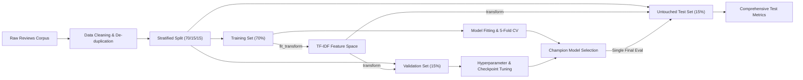

# 📊 McDonald's Review Sentiment Intelligence & Research-Grade Evaluation Platform

> An enterprise-grade Machine Learning & NLP Analytics Platform featuring a rigorous, publication-quality evaluation pipeline for 3-class customer review sentiment analysis (`Negative`, `Neutral`, `Positive`), multi-model benchmarking, interactive web dashboards, bulk review processing, and explainability.

---

## 🔬 Research & Experimental Methodology

### 1. Dataset & Class Distribution
The dataset consists of free-text customer reviews from Google Maps reviews of McDonald's restaurants.

| Sentiment Class | Proportions | Characteristics & Challenges |
| :--- | :--- | :--- |
| **Negative** | **47.34%** | Service delays, order inaccuracies, food quality complaints, cold food |
| **Positive** | **36.94%** | Fast drive-thru, clean locations, friendly staff, hot & fresh food |
| **Neutral** | **15.73%** | Moderate reviews, mixed opinions, indifferent ratings, borderline polarity |

> [!IMPORTANT]
> **Why Accuracy Alone is Insufficient**: Due to class imbalance (Neutral is only 15.73% of the dataset), a naive classifier predicting only Negative and Positive can achieve high accuracy (~84%) while completely failing to identify Neutral reviews (Neutral F1 ≈ 0). Therefore, **Macro F1** is treated as the primary benchmark metric.

---

### 2. Zero-Leakage Experimental Split
To eliminate data leakage, the corpus is partitioned into a strict **3-way stratified split**:
- **70% Training Set**: Used exclusively for model fitting and TF-IDF vocabulary construction.
- **15% Validation Set**: Used exclusively for hyperparameter tuning, loss function weighting, and Transformer checkpoint selection / early stopping.
- **15% Final Untouched Test Set**: Strictly held out until final unbiased evaluation. Never exposed during feature selection, vectorizer fitting, or hyperparameter selection.



---

## 🤖 Model Suite & Architectures

1. **TF-IDF + Linear SVM (`LinearSVC`)**:
   - Hyperplane classifier with cost-sensitive `class_weight='balanced'` to handle the minority Neutral class.
   - N-gram representation: Unigrams + Bigrams, Sublinear TF scaling, max 20,000 features.
2. **TF-IDF + Logistic Regression**:
   - L2-regularized probabilistic classifier with balanced class weights and calibrated probability outputs.
3. **TF-IDF + Multinomial Naive Bayes**:
   - Classical generative probabilistic baseline with Laplace smoothing (`alpha=1.0`).
4. **Fine-Tuned DistilBERT (`distilbert-base-uncased`)**:
   - 66M parameter deep bidirectional Transformer with self-attention.
   - Fine-tuned using cost-sensitive weighted `CrossEntropyLoss` with checkpoint selection driven by validation Macro F1.
5. **VADER Rule-Based Baseline**:
   - Lexicon- and rule-based sentiment intensity analyzer with standard polarity thresholds.

---

## 📂 Project Architecture & Directory Map

```
SENTIMENTAL ANALYSIS/
├── data/                                 # Central Data Repository
│   ├── README.md                         # Data lineage & schema documentation
│   ├── DATASET.csv                       # Raw original McDonald's reviews (33,396 rows)
│   ├── cleaned_reviews.csv               # Normalized & cleaned review texts (22,476 rows)
│   └── final_pseudo_labeled_dataset.csv  # Final consensus ground-truth dataset (22,448 rows)
│
├── Figures/                              # Publication-ready diagnostic figures (01 to 11 .png)
│   ├── 01_sentiment_rating_dist.png      # Sentiment vs Star Rating distribution
│   ├── 02_length_by_sentiment.png        # Character length boxplots
│   ├── 03_autotag_share.png              # Google autotag proportions
│   ├── 04_sentiment_over_time.png        # Longitudinal temporal trends
│   ├── 05_wordclouds.png                 # Sentiment lexicons & word clouds
│   ├── 06_top_bigrams.png                # Top positive / negative n-grams
│   ├── 07_confusion_matrix.png           # Multi-class confusion matrices
│   ├── 08_model_comparison.png           # Accuracy, F1 & Recall benchmarks
│   ├── 09_top_predictive_words.png       # Feature importance / model weights
│   ├── 10_vader_vs_rating.png            # Unsupervised VADER baseline correlation
│   └── 11_vader_confusion_matrix.png     # VADER error analysis matrix
│
├── frontend/                             # Enterprise React 18 + Vite Web Application
│   ├── src/
│   │   ├── components/                   # Navbar, Sidebar, KPI Cards, Filter Bar
│   │   ├── views/
│   │   │   ├── OverviewView.jsx          # Executive KPI summary & sentiment share
│   │   │   ├── PredictorView.jsx         # Live Single Predictor + Multi-Model Sandbox
│   │   │   ├── BatchUploadView.jsx       # Bulk CSV/XLSX/JSON Ingestion & Intelligence
│   │   │   ├── AnalyticsView.jsx         # Deep-dive analytics & figures gallery
│   │   │   ├── ReviewsView.jsx           # Filterable paginated review explorer
│   │   │   ├── ModelsView.jsx            # Model benchmark table & confusion matrices
│   │   │   └── ReportsView.jsx           # Dynamic executive report generator & exporter
│   │   ├── services/api.js               # REST API Axios client
│   │   └── App.jsx                       # Application routing & layout shell
│   └── package.json
│
├── labeling/                             # Active Learning & Human Annotation Protocol
│   ├── README.md                         # Labeling methodology & IAA guidelines
│   ├── decisions/                        # Semi-supervised decision records
│   ├── docs/                             # Annotation guidelines & edge cases
│   ├── pilot/                            # 3-annotator blinded sheets & sample data
│   ├── reports/                          # Fleiss' Kappa (0.6287), Krippendorff's Alpha & IAA
│   └── scripts/                          # Pilot sampling, IAA computation & dataset builders
│
├── models/                               # Serialized Classifiers & Transformers
│   ├── best_sentiment_model.pkl          # Champion deployment model
│   ├── linear_svm_model.pkl              # Trained Linear Support Vector Classifier
│   ├── logistic_regression_model.pkl     # Trained Logistic Regression classifier
│   ├── naive_bayes_model.pkl             # Multinomial Naive Bayes classifier
│   ├── tfidf_vectorizer.pkl              # Fitted TF-IDF feature transformer
│   └── distilbert_sentiment/             # HuggingFace DistilBERT weights & tokenizer
│
├── notebooks/                            # End-to-End Research Jupyter Notebooks
│   ├── 01 Data Cleaning & Preprocessing.ipynb
│   ├── 02 Exploratory Data Analysis.ipynb
│   ├── 03 Text Preprocessing & Lexical Exploration.ipynb
│   └── 04 Modelling.ipynb
│
├── reports/                              # Academic Deliverables & Documentation
│   ├── README.md                         # Reports directory overview
│   ├── 22CDS0412.docx                    # Final Capstone Thesis Document
│   ├── McDonalds_Review_Sentiment_Analysis_Capstone_Final_Audit_Report.pdf
│   ├── McDonalds_Sentiment_Analysis_Data_Pipeline_Methodology_Report.pdf
│   └── generate_pipeline_pdf.py          # Technical PDF generator script
│
├── results/                              # Quantitative Benchmark CSVs & Logs
│   ├── classification_metrics.csv        # Final benchmark test metrics
│   ├── cross_validation_results.csv      # 5-Fold CV Mean ± SD metrics
│   ├── efficiency_benchmark.csv          # Latency & throughput profiles
│   ├── ablation_results.csv              # Feature & loss ablation study logs
│   ├── error_analysis.csv                # Misclassification diagnostic data
│   ├── robustness_results.csv            # OOD perturbation challenge results
│   ├── summary.json                      # Project-wide metrics summary
│   └── confusion_matrices/               # Serialized confusion matrices
│
├── src/                                  # Modular Python Core Library
│   ├── data_loader.py                    # Data ingestion & audit pipeline
│   ├── feature_engineering.py            # TF-IDF, lexical features & vectorizers
│   ├── models.py                         # Model architectures & training routines
│   ├── evaluation_metrics.py             # Accuracy, Macro F1, Recall & report engines
│   ├── explainability.py                 # Feature weights & token attribution
│   ├── cross_validation.py               # Stratified 5-Fold CV evaluation
│   ├── error_analysis.py                 # Model misclassification diagnostics
│   ├── efficiency.py                     # Inference latency & memory profiler
│   ├── ablation_studies.py               # Feature ablation analysis
│   └── robustness_testing.py             # Typo & noise injection robustness suite
│
├── server.py                             # High-Performance FastAPI REST Server
├── run_evaluation_pipeline.py            # Automated Master Evaluation Pipeline
├── requirements.txt                      # Python dependencies
└── README.md                             # Project documentation & architecture guide
```

---

## ⚙️ Quick Start & Reproducibility

### 1. Install Dependencies
```powershell
pip install -r requirements.txt
```

### 2. Run the Full Research Evaluation Pipeline
```powershell
python run_evaluation_pipeline.py
```
*Executes the end-to-end audit, generates the 70/15/15 split, trains/benchmarks all classical models, evaluates DistilBERT and VADER, runs cross-validation, executes robustness tests and error analysis, and exports all CSV/JSON/PNG artifacts.*

### 3. Launch Backend REST API & React Frontend Dashboard
```powershell
# Terminal 1: Start FastAPI REST Backend (port 8000)
python server.py

# Terminal 2: Launch React 18 Web Dashboard (port 5173)
cd frontend
npm install
npm run dev
```

Open [http://localhost:5173](http://localhost:5173) in your browser.

---

## ⚠️ Known Limitations & Academic Scope
1. **Class Imbalance**: The minority Neutral class (15.73%) exhibits lower F1 scores across all models compared to polarized Positive and Negative classes.
2. **Context & Sarcasm**: Classical bag-of-words models fail on subtle sarcasm (*"Great, another 2-hour wait"*) and contrastive clauses (*"Food was good but staff was rude"*), whereas Transformer attention captures contextual nuance.
3. **Lexical Domain Specificity**: The vocabulary is specific to fast-food customer experiences (drive-thru, fries, kiosks); domain transfer to other review types may require fine-tuning.
4. **Computational Latency Trade-off**: Linear SVM achieves sub-millisecond inference latency compared to ~8.5 ms/sample for DistilBERT on CPU, representing a significant throughput advantage for real-time edge deployment.
